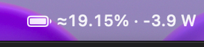
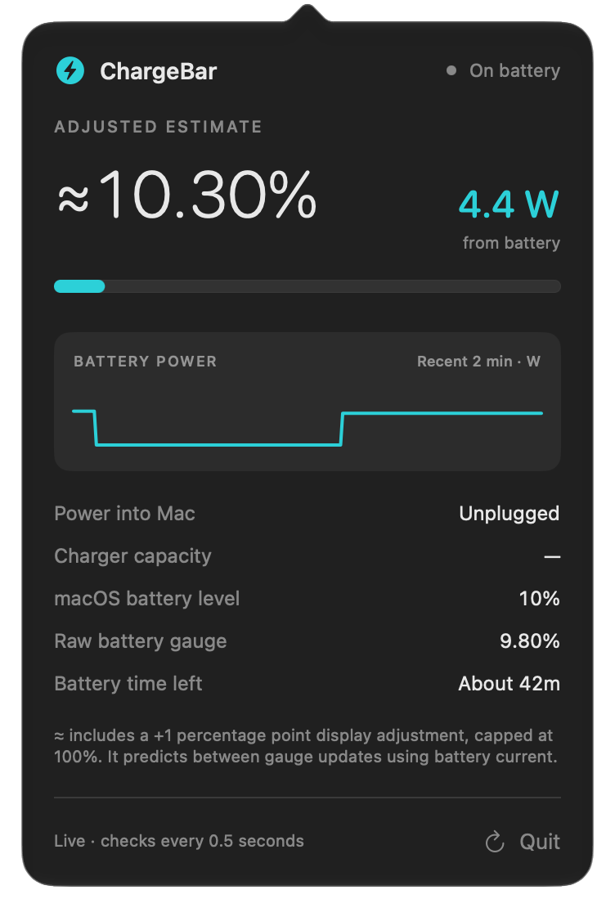

<div align="center">

# ⚡ ChargeBar

**Live battery power, estimated charge and time remaining in your Mac's menu bar.**

[Download DMG](https://github.com/1Utkarsh1/ChargeBar/releases/download/v1.3.2/ChargeBar.dmg) · [Download ZIP](https://github.com/1Utkarsh1/ChargeBar/releases/download/v1.3.2/ChargeBar.zip) · [Releases](https://github.com/1Utkarsh1/ChargeBar/releases) · [Report a bug](https://github.com/1Utkarsh1/ChargeBar/issues/new/choose)


[](https://github.com/1Utkarsh1/ChargeBar/actions/workflows/build.yml)

</div>

ChargeBar is a small native macOS menu bar app. See a compact reading such as **`≈57.89% · +12.1 W`**, then click it for the details. It uses Apple's AppKit, SwiftUI and IOKit frameworks and runs entirely on your Mac.

## Screenshots

### Menu bar

Estimated charge and live battery watts, visible at a glance.

<p align="center">
  
</p>

### Battery panel

Click the menu bar reading for power history, charger details and estimated time remaining.

<p align="center">
  
</p>

## Features

- **Live battery watts** — positive while energy enters the battery, negative while it leaves.
- **Estimated decimal percentage** — predicts between hardware readings using battery current.
- **Charging and connection state** — responds to macOS power-change notifications, with checks every 0.5 seconds while the panel is open or closed.
- **Battery time remaining** — a macOS estimate, with a capacity/current fallback when available.
- **Power details** — adapter input, charger capacity, time until full and a recent battery-power chart.

> [!IMPORTANT]
> The `≈` percentage is an estimate with a **+1 percentage point display adjustment**, capped at **100.00%**. For example, 56.89% becomes ≈57.89%. It can reach 100% before the battery is physically full. The panel also shows the unadjusted raw gauge and macOS battery level. Two decimal places do not imply measurement accuracy of 0.01%.

## Install

1. Download [ChargeBar.dmg](https://github.com/1Utkarsh1/ChargeBar/releases/download/v1.3.2/ChargeBar.dmg) from the prerelease.
2. Open the DMG and drag **ChargeBar.app** onto the **Applications** shortcut. If updating, quit the old app before replacing it.
3. Eject the DMG, then open ChargeBar from Applications. Its percentage and watts appear in the menu bar.

Prefer a ZIP? Download [ChargeBar.zip](https://github.com/1Utkarsh1/ChargeBar/releases/download/v1.3.2/ChargeBar.zip), unzip it, and move **ChargeBar.app** into **Applications**.

**Requirements:** an Apple Silicon Mac with a built-in battery, macOS 14 or later. Intel binaries are not included. The initial public preview was tested locally on macOS 27; support across other Macs and macOS versions is still being verified.

The download is locally ad hoc signed and **is not Apple notarized**. macOS may block its first launch. After attempting to open it, use **System Settings → Privacy & Security → Open Anyway** if you choose to allow this download. See [Apple's guidance](https://support.apple.com/en-us/102445).

## Use

Click the menu bar reading to open or close the panel. Its refresh button requests another reading; **Quit** stops the app. Hold **⌘ Command** and drag the menu item to reposition it.

To start ChargeBar at login, add it under **System Settings → General → Login Items**. Login startup and automatic updates are not built into this version; download a newer release to update.

## Understanding the readings

| Reading | Meaning |
| --- | --- |
| Battery watts | Power entering or leaving the battery. |
| Power into Mac | Adapter input, including power used to run the computer. |
| Charger capacity | The connected adapter's reported limit. |
| Adjusted estimate | Smoothed capacity estimate plus the displayed 1-point adjustment. |
| Raw battery gauge | Remaining capacity divided by full-charge capacity, without prediction or the display adjustment. |
| macOS battery level | The whole percentage reported by the operating system. |
| Battery time left | Estimated runtime at current use. Workload and battery reserve affect when low-battery sleep or shutdown occurs. |

The hardware publishes readings in steps. ChargeBar checks every 0.5 seconds and predicts intermediate percentages while current data is valid. It holds the estimate during incompatible or missing current samples and labels prolonged read failures. Prediction stops at two percentage points of disagreement and displays **Waiting for battery gauge…**. If a larger raw-gauge recalibration would require the estimate to move against the power direction, it keeps the previous value and waits for the gauge to catch up. A brief loss of decimal capacity holds the last estimate for up to three seconds with that waiting label, then falls back to the whole macOS value.

Connection status can appear before charging begins while the adapter negotiates power. Watts can settle later than the connection indicator. The decimal estimate holds or decreases while unplugged or draining, and holds or increases with positive charging current. Corrections and brief polling gaps preserve that direction. System wake, an app restart or a complete data outage starts a fresh measurement baseline, allowing for charging while observations were unavailable. Raw gauge and macOS values can still change independently when the battery recalibrates.

See [reading calculations and limits](docs/READINGS.md) for the formulas and fallback behavior.

## Privacy and permissions

ChargeBar has no account, analytics, ads or network requests. Its chart keeps the latest 240 power samples in memory and discards them when the app quits. It does not save or upload battery history.

The app reads the built-in battery's power information. It does not change charging limits or power settings and does not need administrator access, Accessibility or Screen Recording permission to operate.

## Build and contribute

With Apple's Command Line Tools installed:

```bash
git clone https://github.com/1Utkarsh1/ChargeBar.git
cd ChargeBar
bash build.sh
```

The script runs the checks and creates **`dist/ChargeBar.app`**, **`dist/ChargeBar.dmg`** and **`dist/ChargeBar.zip`**. See [building and verification](docs/BUILDING.md), the [local test record](docs/VERIFICATION.md), [contribution guidance](CONTRIBUTING.md) and the [changelog](CHANGELOG.md).

For a bug report, include the exact app and macOS versions, Mac model/chip, charging state, reproduction steps and expected versus displayed readings. Use the [issue forms](https://github.com/1Utkarsh1/ChargeBar/issues/new/choose).

Licensing terms have not yet been specified.
